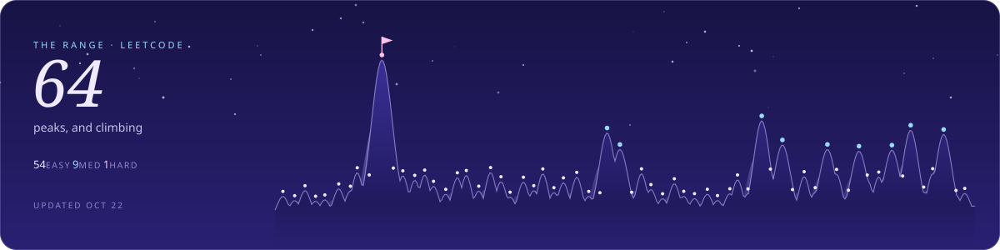

  

<em>A builder who falls down rabbit holes for fun.</em> 
Computer science &amp; math at the University of Ottawa · co-op · Dean's Honour List

 

  
  

  
  

  

<code>Python</code> · <code>C++</code> · <code>TypeScript</code> · <code>JavaScript</code> · <code>Java</code> · <code>SQL</code> · <code>Verilog</code> · <code>React</code> · <code>Node</code> · <code>PostgreSQL</code> · <code>Supabase</code>

 

  

  <a href="https://www.linkedin.com/in/elvya-an%C3%A9-94082a39b/">LinkedIn</a> ·
  <a href="https://leetcode.com/u/Elvya/">LeetCode</a> ·
  <a href="https://classmark.vercel.app">Classmark</a>

